# High-Speed Two-Stage Comparator

[Repository overview](../README.md) · [73-page presentation](2-Stage%20Comparator.pdf) · [Cadence analog library](../data/README.md)

This project evaluates a two-stage open-loop comparator with **NMOS and PMOS differential input pairs** in **90 nm and 180 nm** processes. The design study balances gain, bandwidth, bias current, and buffered-output switching behavior across SS, NN, and FF conditions.

## Circuit Structure and Measurement Nodes

```text
VINP, VINN -> Differential stage -> CS_OUT -> Common-source stage -> VOUT
                                                                        |
                                                          Inverter buffer chain
                                                                        |
                                                                     VOUT2

Bias generator -> Differential-stage tail and second-stage current source
```

[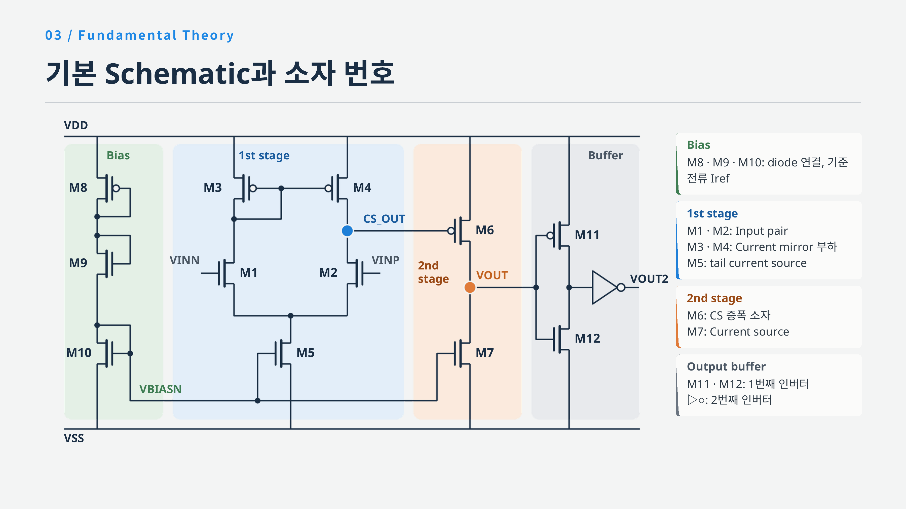](images/report/comparator-topology.png)

Source: [project presentation, page 18](2-Stage%20Comparator.pdf#page=18).

| Circuit Element | Function |
| --- | --- |
| Differential input pair | Amplifies the input voltage difference |
| Current-mirror load | Provides active loading and single-ended conversion |
| Tail current source | Sets the first-stage operating current |
| Common-source stage | Adds gain and develops the analog output VOUT |
| Inverter buffer chain | Converts the amplified signal into buffered output VOUT2 |
| Bias circuit | Establishes and mirrors operating currents |

Gain, -3 dB bandwidth, and unity-gain frequency are measured at **VOUT**. Duty cycle, output swing, and maximum operating frequency are measured at **VOUT2**.

## Design Targets and Conditions

| Parameter | Condition or Target |
| --- | --- |
| Supply | 1.2 V for 90 nm; 2.0 V for 180 nm |
| Corner / temperature | SS / 85 C; NN / 27 C; FF / -25 C |
| Open-loop gain | Above 40 dB |
| Output duty cycle | 40% to 60% |
| Output swing | Low at or below 0.1 VDD; high at or above 0.9 VDD |
| NMOS-input common mode | 0.75 VDD |
| PMOS-input common mode | 0.25 VDD |
| Input sine amplitude | 0.2 V |

The maximum operating-frequency search applies the output swing and duty criteria together. This frequency is a large-signal input test result, whereas unity-gain frequency comes from small-signal AC analysis.

## Four Design Cases

<details>
<summary>90 nm NMOS input pair</summary>

[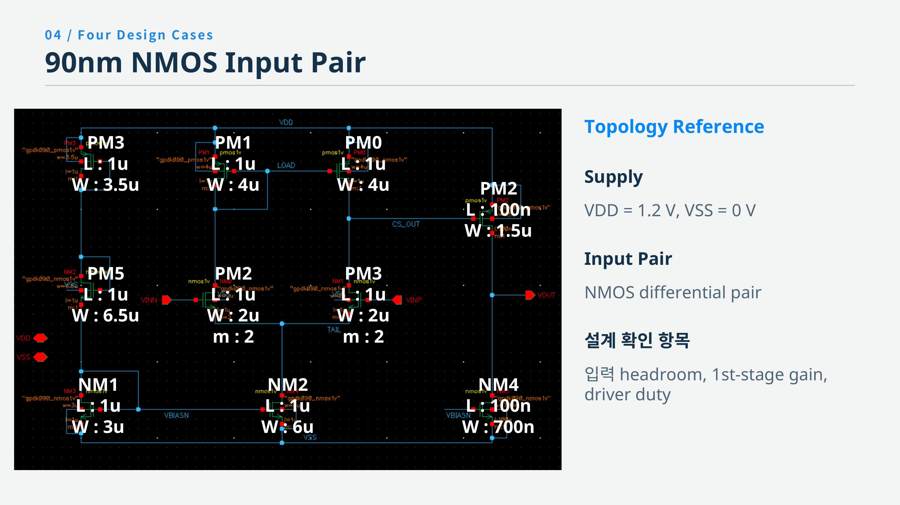](images/report/90nm-nmos-schematic.png)

Source: [project presentation, page 29](2-Stage%20Comparator.pdf#page=29).

</details>

<details>
<summary>90 nm PMOS input pair</summary>

[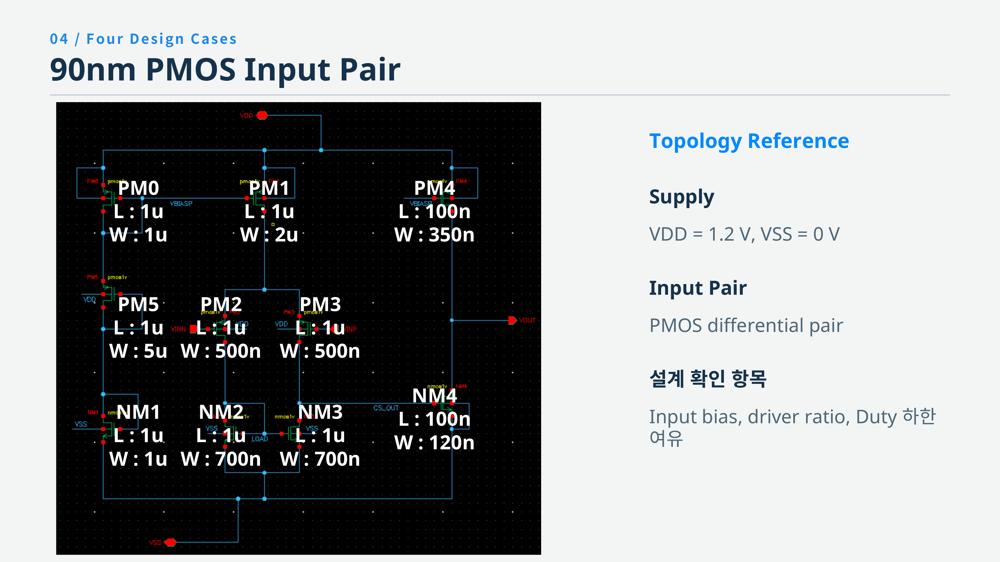](images/report/90nm-pmos-schematic.png)

Source: [project presentation, page 36](2-Stage%20Comparator.pdf#page=36).

</details>

<details>
<summary>180 nm NMOS input pair</summary>

[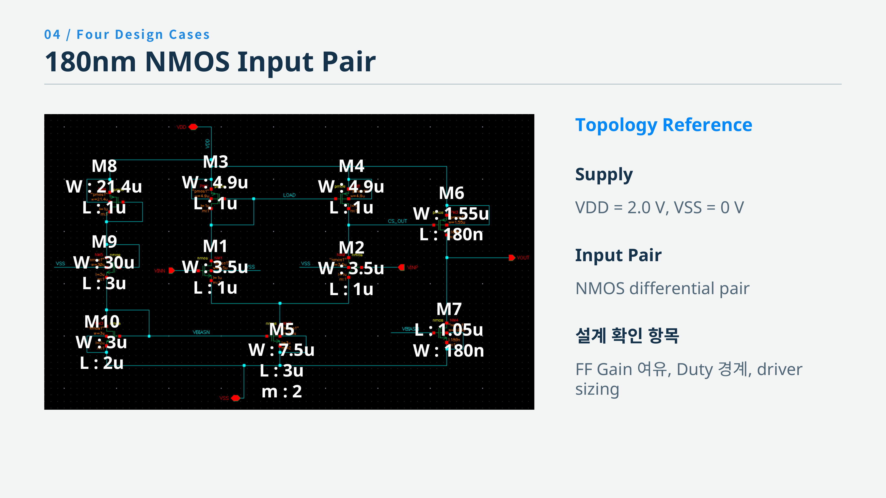](images/report/180nm-nmos-schematic.png)

Source: [project presentation, page 43](2-Stage%20Comparator.pdf#page=43).

</details>

<details>
<summary>180 nm PMOS input pair</summary>

[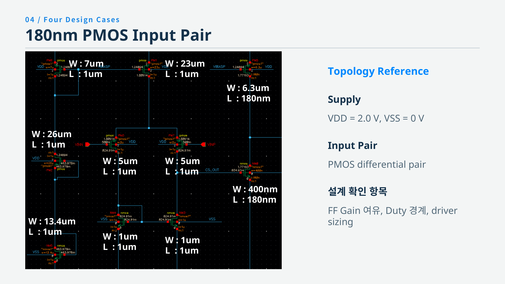](images/report/180nm-pmos-schematic.png)

Source: [project presentation, page 51](2-Stage%20Comparator.pdf#page=51).

</details>

## Reported Corner Results

| Case | Corner | Gain (dB) | Unity-Gain Frequency (GHz) | Reported fmax (GHz) | Duty Cycle (%) |
| --- | --- | ---: | ---: | ---: | ---: |
| 90 nm NMOS | SS / 85 C | 48.95 | 2.540 | 1.245 | 50.55 |
| 90 nm NMOS | NN / 27 C | 46.79 | 4.996 | 2.785 | 45.89 |
| 90 nm NMOS | FF / -25 C | 45.03 | 9.732 | 7.085 | 43.40 |
| 90 nm PMOS | SS / 85 C | 40.1532 | 2.01949 | 2.535 | 56.423 |
| 90 nm PMOS | NN / 27 C | 40.8769 | 3.37895 | 3.445 | 51.9407 |
| 90 nm PMOS | FF / -25 C | 40.2920 | 5.43588 | 4.455 | 49.97301 |
| 180 nm NMOS | SS / 85 C | 43.58 | 2.360 | 1.340 | 43.11 |
| 180 nm NMOS | NN / 27 C | 51.02 | 2.630 | 1.030 | 46.14 |
| 180 nm NMOS | FF / -25 C | 56.97 | 2.940 | 0.749 | 50.71 |
| 180 nm PMOS | SS / 85 C | 55.3449 | 1.20813 | 0.590 | 41.1878 |
| 180 nm PMOS | NN / 27 C | 51.3850 | 1.80066 | 0.950 | 54.0251 |
| 180 nm PMOS | FF / -25 C | 40.1667 | 2.38706 | 1.130 | 59.4633 |

Source: presentation pages 34, 41, 49, and 57. The values reproduce the report's case-summary tables.

<details>
<summary>90 nm NMOS result table</summary>

[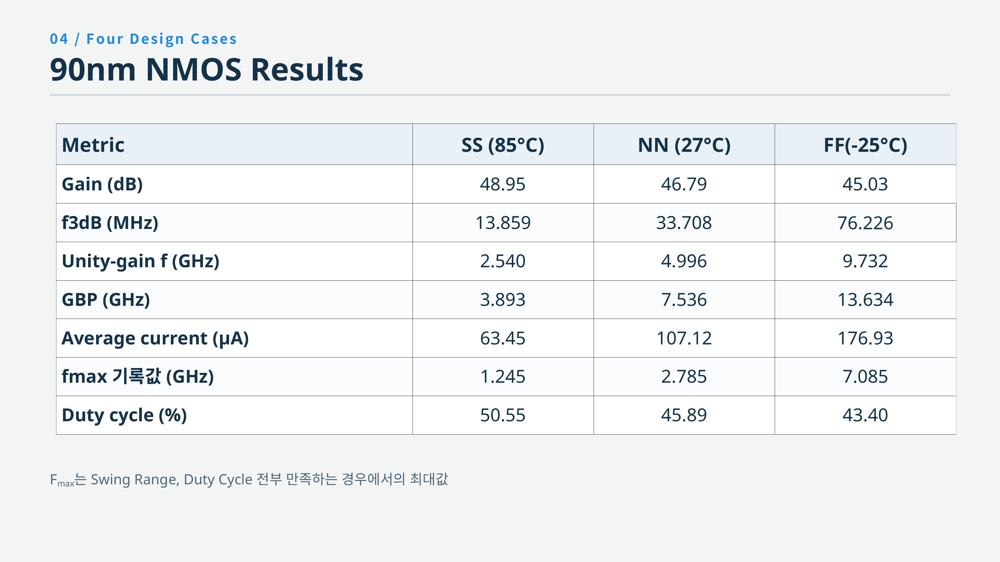](images/report/90nm-nmos-results.png)

Source: [project presentation, page 34](2-Stage%20Comparator.pdf#page=34).

</details>

<details>
<summary>90 nm PMOS result table</summary>

[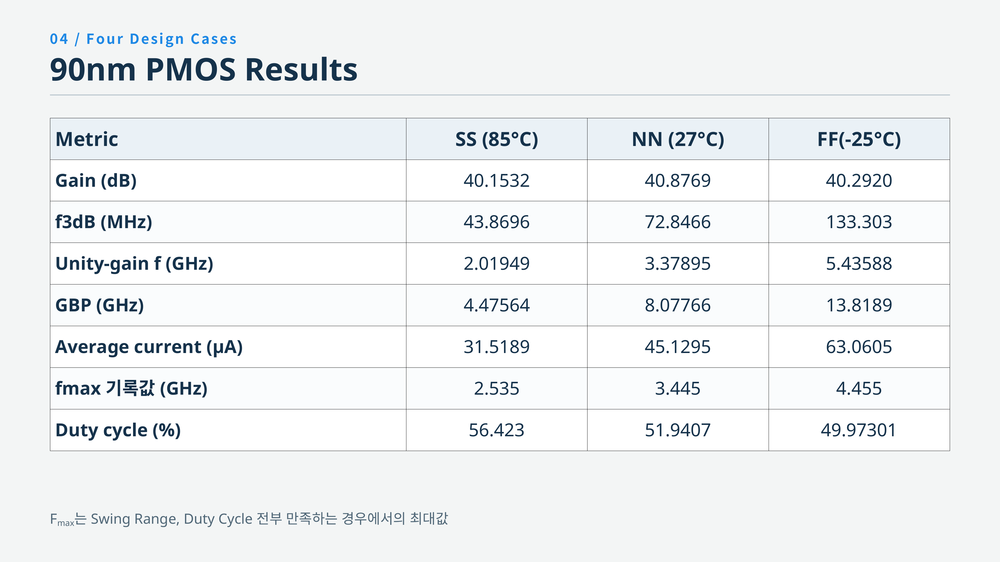](images/report/90nm-pmos-results.png)

Source: [project presentation, page 41](2-Stage%20Comparator.pdf#page=41).

</details>

<details>
<summary>180 nm NMOS result table</summary>

[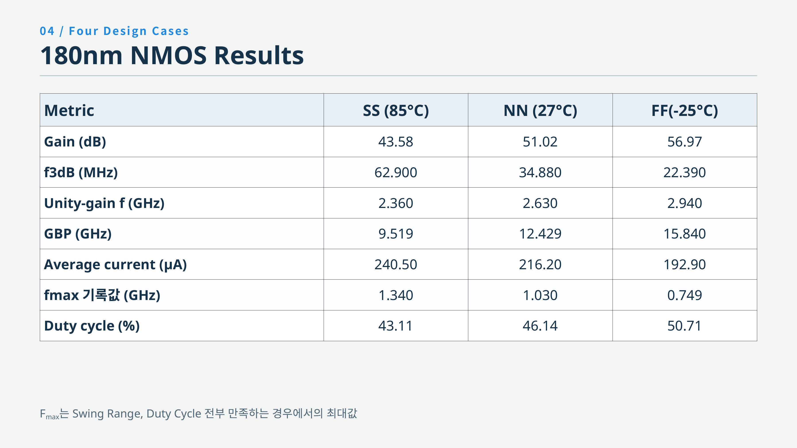](images/report/180nm-nmos-results.png)

Source: [project presentation, page 49](2-Stage%20Comparator.pdf#page=49).

</details>

<details>
<summary>180 nm PMOS result table</summary>

[](images/report/180nm-pmos-results.png)

Source: [project presentation, page 57](2-Stage%20Comparator.pdf#page=57).

</details>

## Gain, Loading, and Pole Analysis

The first-order stage interpretation uses `Av ~ gm * Rout` and `fp ~ 1 / (2*pi*Rout*Cnode)`. Bias and device sizing affect gain and resistance while also changing the capacitance presented to the preceding stage.

The report compares hand calculations with simulation, then refines the pole model by including the inverter input's Miller loading and drain-body junction capacitance. In the illustrated comparison, the second-pole estimate moves from 19.4 GHz with the initial capacitance model to 1.58 GHz after the added loading terms, compared with a simulated 1.391 GHz.

[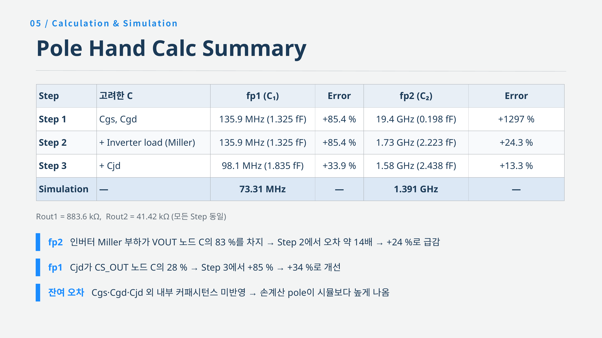](images/report/pole-model-comparison.png)

Source: [project presentation, page 69](2-Stage%20Comparator.pdf#page=69).

The corner results also show that maximum switching frequency need not track unity-gain frequency monotonically. Output headroom, bias balance, and duty distortion are part of the switching test.

## Device Characterization

The image collection includes threshold-characterization schematics and NMOS/PMOS width/length sweeps used to examine device behavior before circuit sizing.

<details>
<summary>NMOS threshold-characterization schematic</summary>

[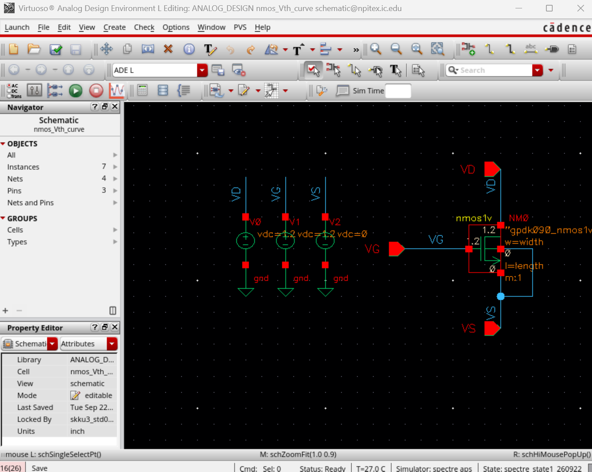](images/nmos_vth_schematic.png)

</details>

<details>
<summary>NMOS and PMOS parameter sweeps</summary>

[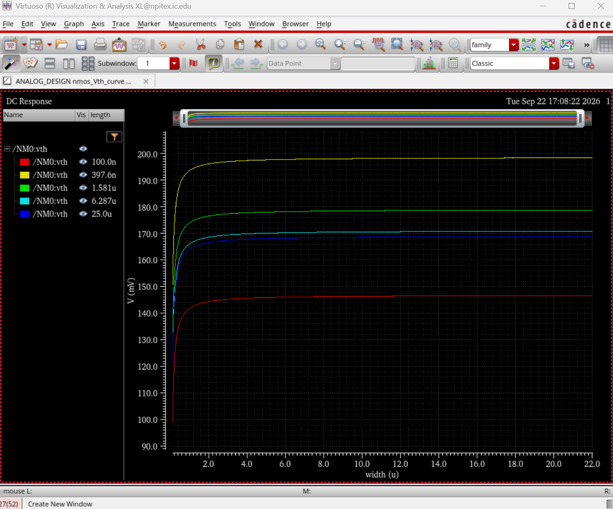](images/nmos_width_lengthparameter_sweep_vth_sim.png)

[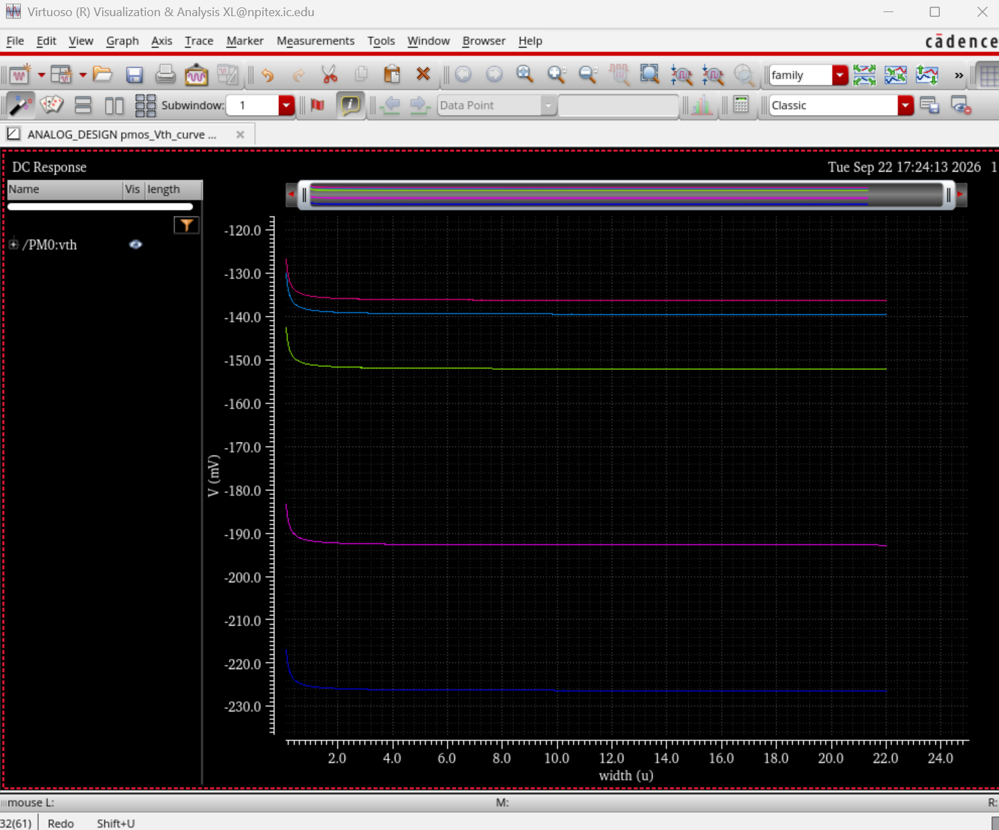](images/pmos_width_lengthparameter_sweep_vth_sim.png)

</details>

## Files and Sources

| Location | Contents |
| --- | --- |
| [images](images/) | Device-characterization screenshots |
| [images/report](images/report/) | Comparator schematics, result tables, and pole analysis |
| [Presentation](2-Stage%20Comparator.pdf) | Complete 73-page study |
| [Analog library](../data/README.md) | Comparator cells and saved simulation states |
