# Miller-Compensated Two-Stage OP-AMP

[Repository overview](../README.md) · [95-page presentation](2-Stage%20OP-AMP.pdf) · [Cadence analog library](../data/README.md)

This project designs two-stage CMOS operational amplifiers in **GPDK090 and GPDK180**, comparing **NMOS and PMOS input pairs** across three process/temperature conditions. The study covers biasing, compensation, small-signal response, input offset, large-signal response, and closed-loop applications.

## Circuit Structure

```text
VINP, VINN
    |
Differential input pair + current-mirror active load
    |
 CS_OUT ---------------- Cc ----------------+
    |                                      |
Common-source second stage -------------- VOUT -> CL

Start-up + beta-multiplier -> Bias -> Tail and output-stage currents
```

[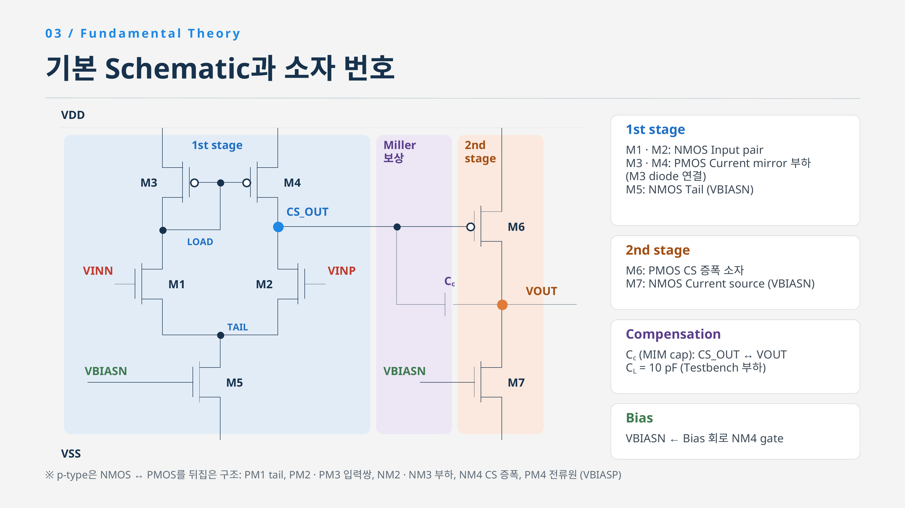](images/report/opamp-topology.png)

Source: [project presentation, page 23](2-Stage%20OP-AMP.pdf#page=23).

| Block | Role |
| --- | --- |
| Differential input stage | Converts the differential input into first-stage gain |
| Current-mirror active load | Supports differential-to-single-ended conversion and output resistance |
| Common-source second stage | Adds voltage gain and drives the output node |
| Miller capacitor | Connects CS_OUT and VOUT for frequency compensation |
| Start-up circuit | Establishes bias current from the zero-current state |
| Beta-multiplier and mirrors | Generate and distribute bias currents |

The PMOS-input implementation reverses the input-stage transistor polarities and uses the corresponding bias polarity.

## Design Conditions and Targets

| Parameter | Condition or Target |
| --- | --- |
| Process / VDD | 90 nm / 1.2 V; 180 nm / 2.0 V |
| Process / temperature | SS / 85 C; NN / 27 C; FF / -25 C |
| Load capacitor CL | 10 pF |
| Compensation capacitor Cc | 2 pF |
| Open-loop gain | At least 57 dB |
| Phase margin | At least 60 degrees |
| Unity-gain frequency | At least 1 MHz |
| Input offset magnitude | At most 1.5 mV |
| Closed-loop applications | Voltage follower, inverting amplifier, non-inverting amplifier |

Targets are from presentation pages 4-5. Application experiments include 100 kHz amplifier operation; the guide below also describes the feedback-resistor loading experiment.

## Bias Generation

The bias design combines a start-up path, a resistor-based beta-multiplier, and mirrored bias outputs. The reference establishes tail and second-stage currents, which influence transconductance, output resistance, slew rate, and quiescent current.

[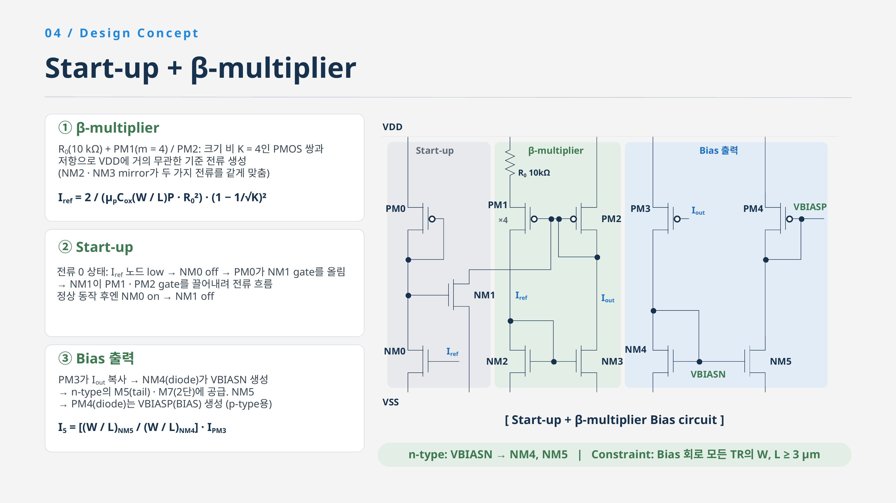](images/report/startup-beta-multiplier.png)

Source: [project presentation, page 37](2-Stage%20OP-AMP.pdf#page=37).

<details>
<summary>90 nm NMOS amplifier and bias screenshots</summary>

[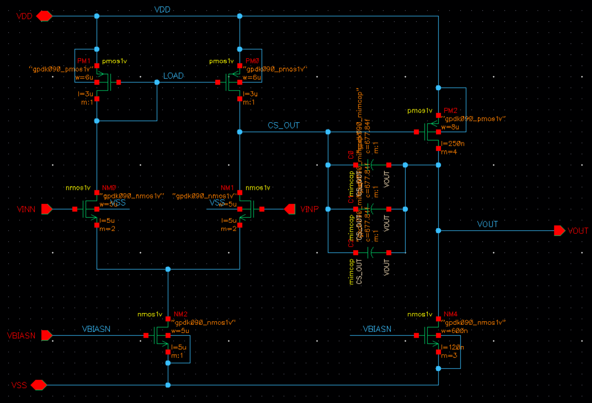](images/90nm_nmos_schematic_amp.png)

[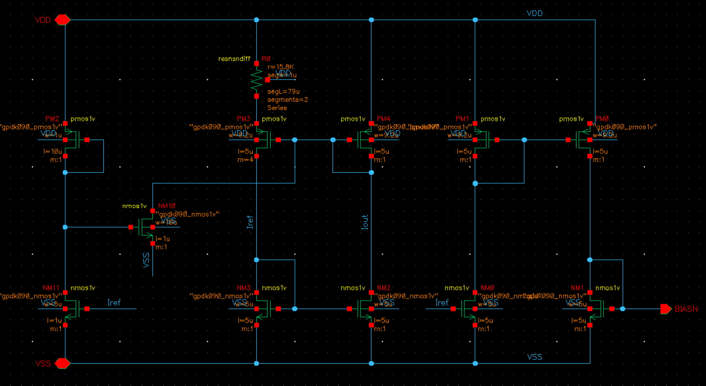](images/90nm_nmos_schematic_bias.png)

[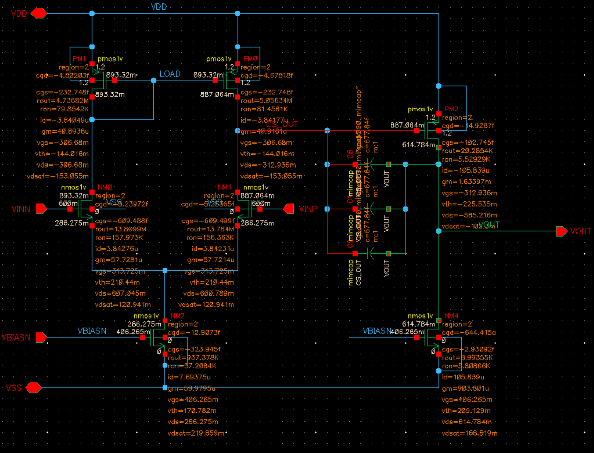](images/90nm_nmos_DC_operating_amp.png)

[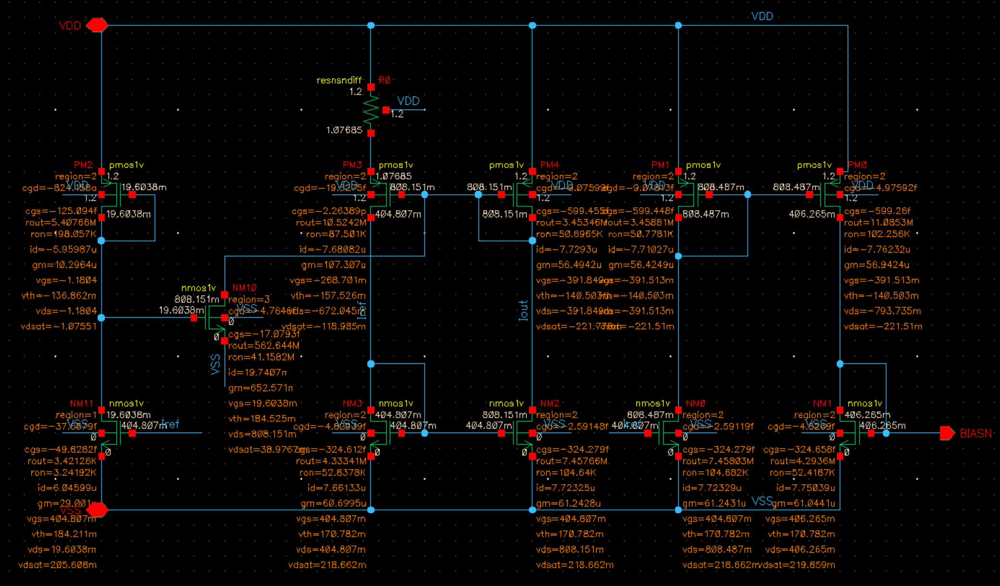](images/90nm_nmos_DC_operating_bias.png)

</details>

## Four Design Cases

Each case uses the same two-stage compensation concept, with process- and input-pair-specific sizing.

<details>
<summary>90 nm NMOS input pair</summary>

[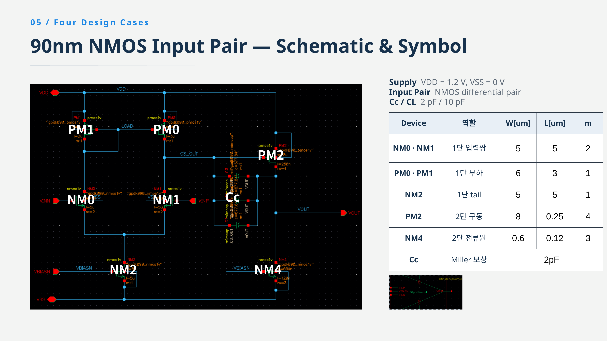](images/report/90nm-nmos-schematic.png)

Source: [project presentation, page 40](2-Stage%20OP-AMP.pdf#page=40).

</details>

<details>
<summary>90 nm PMOS input pair</summary>

[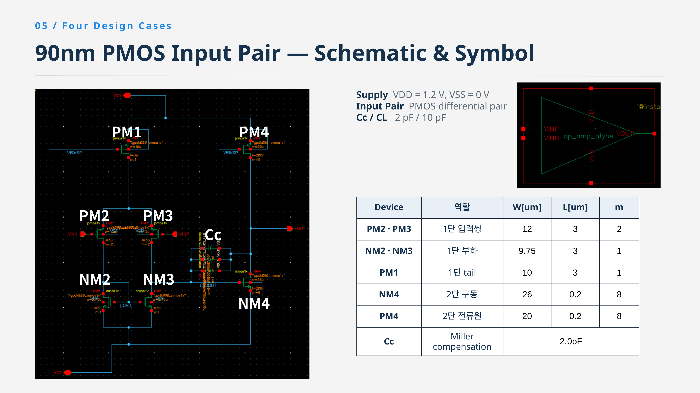](images/report/90nm-pmos-schematic.png)

Source: [project presentation, page 49](2-Stage%20OP-AMP.pdf#page=49).

</details>

<details>
<summary>180 nm NMOS input pair</summary>

[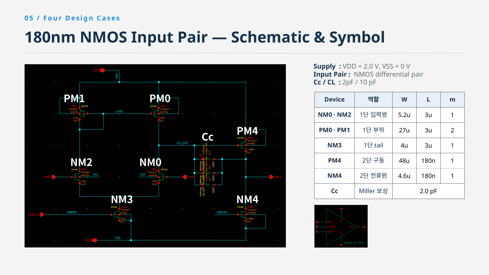](images/report/180nm-nmos-schematic.png)

Source: [project presentation, page 58](2-Stage%20OP-AMP.pdf#page=58).

</details>

<details>
<summary>180 nm PMOS input pair</summary>

[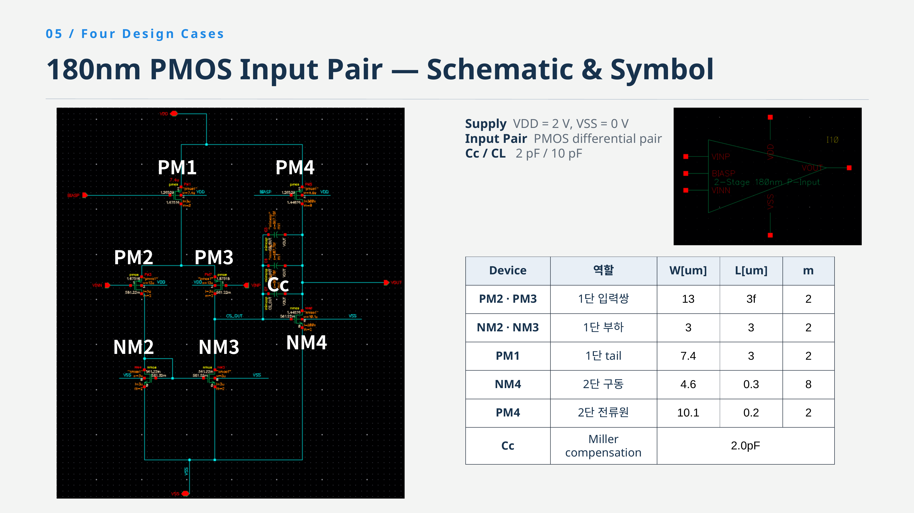](images/report/180nm-pmos-schematic.png)

Source: [project presentation, page 67](2-Stage%20OP-AMP.pdf#page=67).

</details>

## AC Response and Corner Comparison

Miller compensation separates the dominant and higher-frequency poles. Increasing compensation capacitance can improve stability while reducing bandwidth and slew capability, so the design balances Cc, stage transconductance, and load.

| Case | Corner | Gain (dB) | Phase Margin (degrees) | Unity-Gain Frequency (MHz) |
| --- | --- | ---: | ---: | ---: |
| 90 nm NMOS | FF / -25 C | 65.58 | 66.57 | 5.23 |
| 90 nm NMOS | NN / 27 C | 66.51 | 71.76 | 3.88 |
| 90 nm NMOS | SS / 85 C | 66.44 | 76.10 | 2.66 |
| 90 nm PMOS | FF / -25 C | 66.31 | 76.02 | 7.53 |
| 90 nm PMOS | NN / 27 C | 67.70 | 78.03 | 5.54 |
| 90 nm PMOS | SS / 85 C | 67.90 | 79.54 | 4.19 |
| 180 nm NMOS | FF / -25 C | 77.35 | 60.81 | 12.16 |
| 180 nm NMOS | NN / 27 C | 78.64 | 62.71 | 7.78 |
| 180 nm NMOS | SS / 85 C | 79.60 | 64.66 | 5.01 |
| 180 nm PMOS | FF / -25 C | 78.39 | 80.01 | 7.31 |
| 180 nm PMOS | NN / 27 C | 78.47 | 79.93 | 5.57 |
| 180 nm PMOS | SS / 85 C | 69.71 | 80.58 | 4.20 |

Source: presentation page 18. The table reports simulated results, with gain, stability, and bandwidth retained as separate metrics.

<details>
<summary>Original AC summary</summary>

[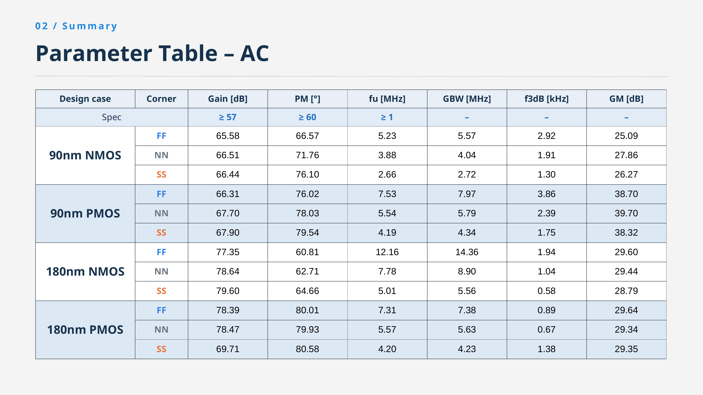](images/report/ac-results-all-corners.png)

Source: [project presentation, page 18](2-Stage%20OP-AMP.pdf#page=18).

</details>

<details>
<summary>90 nm NMOS AC testbench and NN waveform</summary>

[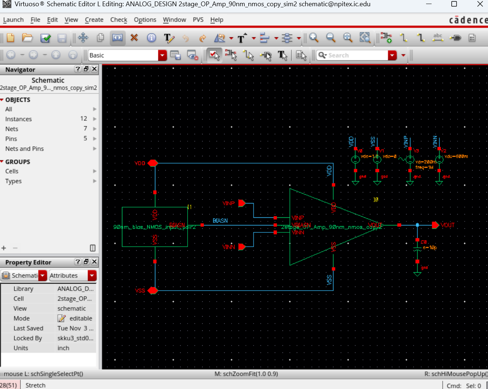](90nm_NMOS_AC/90nm_nmos_AC_schematic.png)

[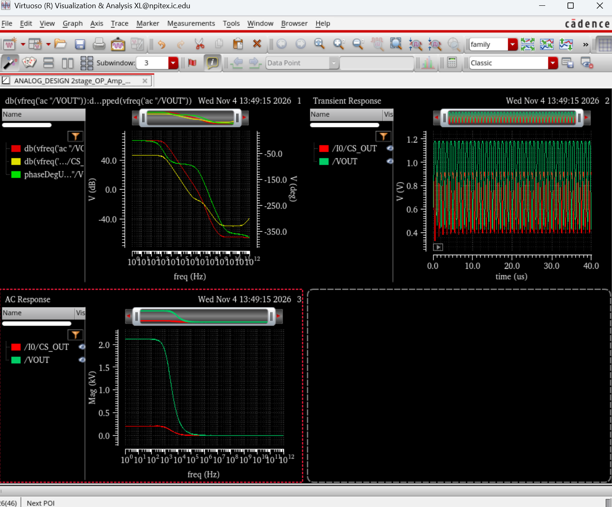](90nm_NMOS_AC/90nm_nmos_AC_sim_NN2.png)

</details>

## DC, Transient, and Closed-Loop Applications

DC sweeps evaluate transfer behavior and input offset. Transient simulations evaluate follower response and large-signal slew. Closed-loop tests include an inverting gain of -1 and a non-inverting gain of 2 with equal input/feedback resistor values.

<details>
<summary>DC and transient result summary</summary>

[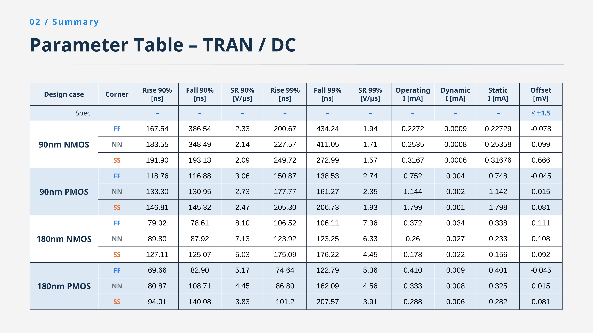](images/report/dc-transient-results-all-corners.png)

Source: [project presentation, page 19](2-Stage%20OP-AMP.pdf#page=19).

</details>

<details>
<summary>90 nm NMOS DC and transient testbenches</summary>

[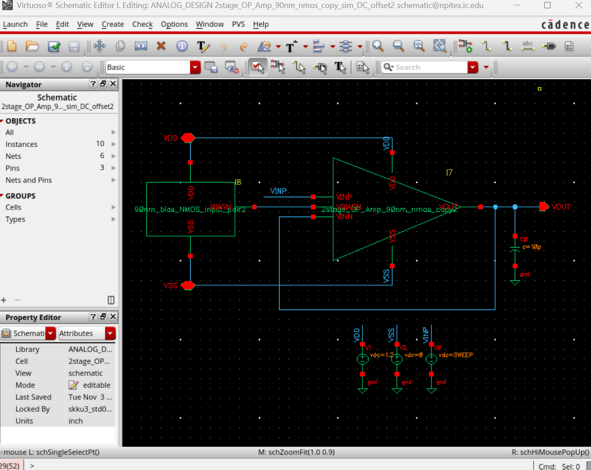](90nm_NMOS_DC/90nm_nmos_DC_schematic.png)

[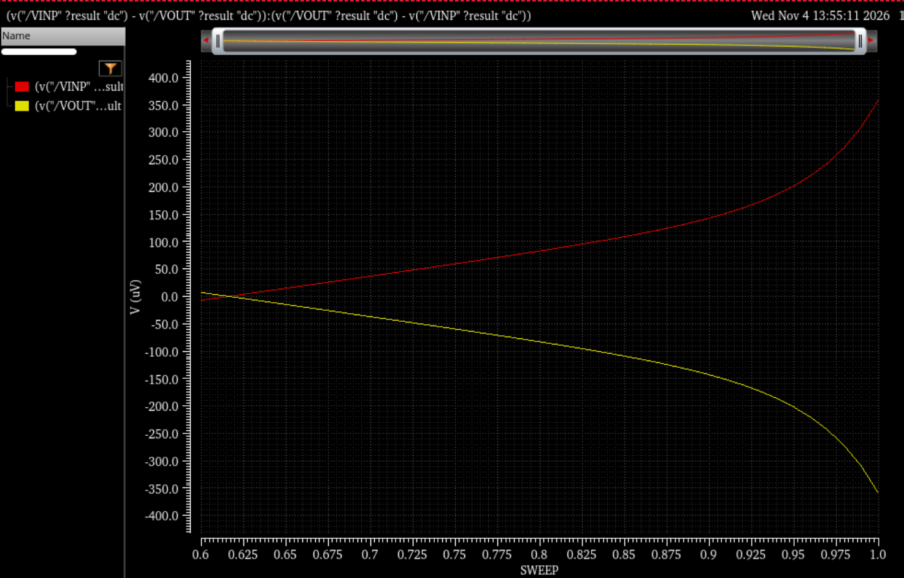](90nm_NMOS_DC/90nm_nmos_DC_offset_NN2.png)

[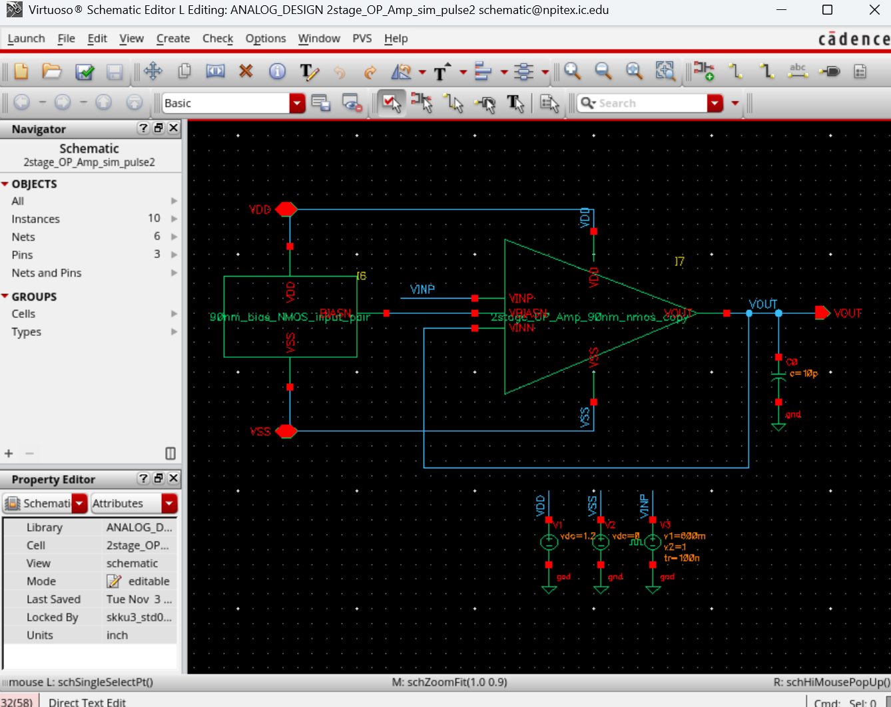](90nm_NMOS_TRAN/90nm_nmos_TRAN_schematic.png)

[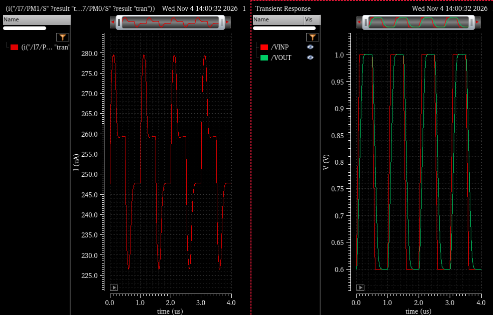](90nm_NMOS_TRAN/90nm_nmos_TRAN_sim_NN2.png)

</details>

### Feedback Resistor Loading

The 90 nm NMOS inverting-amplifier experiment keeps resistor ratio and ideal gain unchanged while increasing both resistors from 1 kohm to 2 kohm. At 100 kHz with a 0.1 V output amplitude, the reported waveform becomes less distorted with the larger resistors. The analysis considers the reduction in resistive feedback current from approximately 100 uA to 50 uA; it treats output-current limitation as an explanatory hypothesis.

[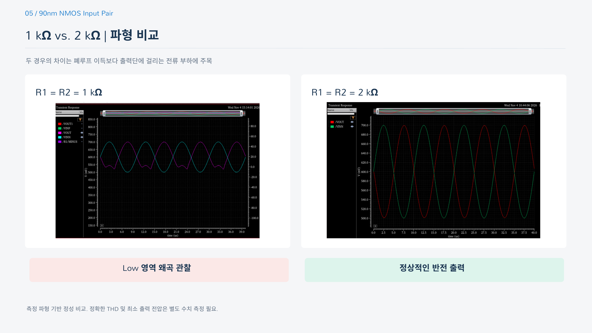](images/report/feedback-resistor-comparison.png)

Source: [project presentation, page 90](2-Stage%20OP-AMP.pdf#page=90).

### Process-Corner Interpretation

The 180 nm PMOS SS-case analysis relates reduced second-stage gain to output-device operating-point changes and examines the resulting Miller loading and dominant-pole shift. It demonstrates why gain and pole location must be interpreted together with the DC operating point.

<details>
<summary>180 nm PMOS SS operating-point and pole analysis</summary>

[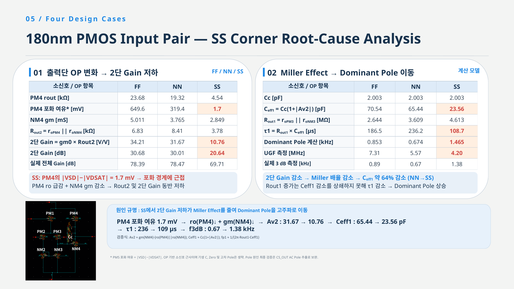](images/report/180nm-pmos-ss-analysis.png)

Source: [project presentation, page 72](2-Stage%20OP-AMP.pdf#page=72).

</details>

## Files and Sources

| Location | Contents |
| --- | --- |
| [images](images/) | Amplifier/bias schematics, operating points, and application plots |
| [90nm_NMOS_AC](90nm_NMOS_AC/) | AC testbench and FF/NN/SS responses |
| [90nm_NMOS_DC](90nm_NMOS_DC/) | DC offset setup and corner sweeps |
| [90nm_NMOS_TRAN](90nm_NMOS_TRAN/) | Transient setup and corner waveforms |
| [images/report](images/report/) | Four design cases, compensation, and report tables |
| [Presentation](2-Stage%20OP-AMP.pdf) | Complete 95-page study |
| [Analog library](../data/README.md) | OpenAccess cell and ADE-state guide |
