# CMOS Repeater Design and PPA Analysis

[Repository overview](../README.md) · [Project presentation](Digital_IC_Project_Repeater.pdf) · [Beta-ratio notes](result_data/Beta_ratio.md)

This project compares CMOS inverter repeaters across **45 nm, 90 nm, and 180 nm** processes, **1X/2X/4X** transistor multipliers, and two loading arrangements. The analysis links switching behavior to equivalent on-resistance, load capacitance, supply current, and transistor size.

## Testbench Structure

```text
Pulse input -> Input buffer stages -> Driver -> Load inverter(s)
                                      |
                          Measure VIN, VOUT, IDD, ISS
```

The third inverter is the measured driver in the baseline chain. Its supply paths are separated from the surrounding stages for current measurement. An additional 90 nm experiment adds input buffers to examine the influence of driver input slew.

### Same-Load Configuration

Each size factor uses a driver and one equally sized load inverter. The 1X, 2X, and 4X paths scale the driver and load together.

[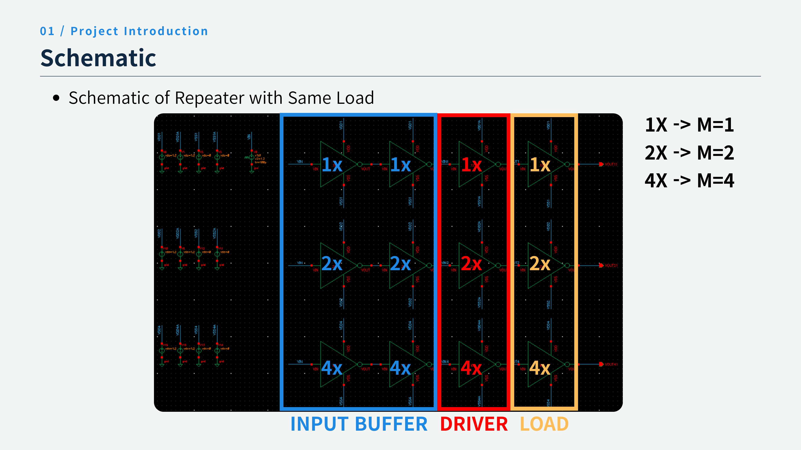](images/report/same-load-topology.png)

Source: [project presentation, page 10](Digital_IC_Project_Repeater.pdf#page=10).

### Multi-Load Configuration

The 1X path drives one 1X load, the 2X path drives two 2X loads, and the 4X path drives four 4X loads. Consequently, both individual load size and fanout change across paths.

[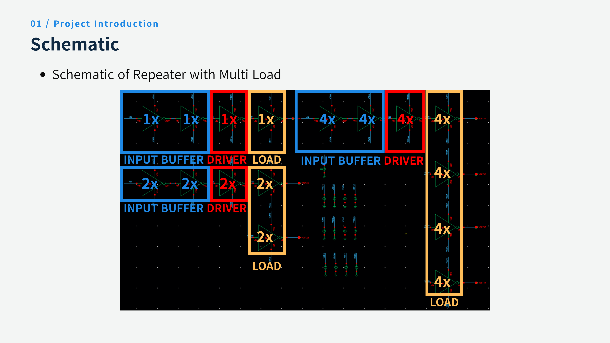](images/report/multi-load-topology.png)

Source: [project presentation, page 11](Digital_IC_Project_Repeater.pdf#page=11).

## Process and Simulation Conditions

| Process | VDD | NMOS L / W | PMOS L / W |
| --- | ---: | --- | --- |
| GPDK045 | 1.1 V | 45 nm / 120 nm | 45 nm / 140 nm |
| GPDK090 | 1.2 V | 100 nm / 120 nm | 100 nm / 350 nm |
| GPDK180 | 2.0 V | 180 nm / 400 nm | 180 nm / 1800 nm |

The input period is 1 ns, with 100 ps rise and fall times and 400 ps pulse width. The compared process/temperature combinations are SS / 85 C, NN / 27 C, and FF / -25 C.

<details>
<summary>Original simulation-condition table</summary>

[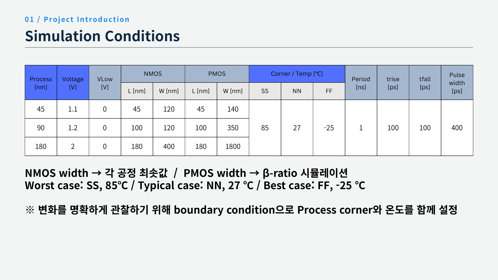](images/report/simulation-conditions.png)

Source: [project presentation, page 13](Digital_IC_Project_Repeater.pdf#page=13).

</details>

## Inverter Sizing and Switching Balance

PMOS width is swept with NMOS geometry fixed. The VTC switching point, where `VIN = VOUT`, is used to select a width ratio near balanced pull-up and pull-down behavior.

```text
beta_n = mu_n * Cox * (Wn / Ln)
beta_p = mu_p * Cox * (Wp / Lp)

VTC sizing objective: Vm near VDD / 2
```

The width ratio `Wp/Wn` and the drive-strength ratio `beta_p/beta_n` describe different quantities: mobility and channel length also contribute to drive strength. Scaling the entire inverter by 1X, 2X, or 4X retains the relative PMOS/NMOS sizing while changing total device size.

[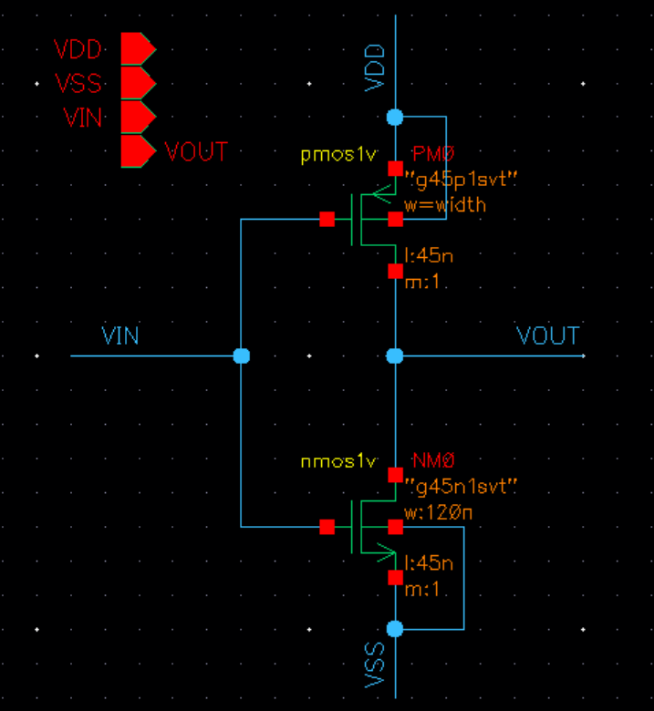](1X_INVERTER/1x_inverter_schematic.png)

<details>
<summary>VTC and PMOS-width sweep</summary>

[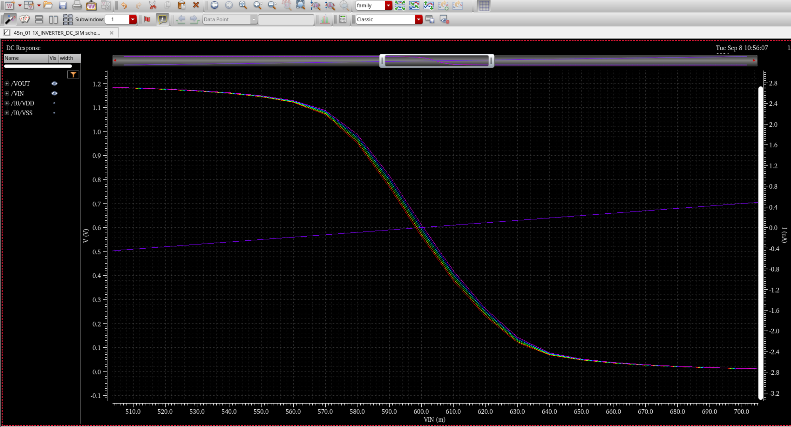](1X_INVERTER/1x_inverter_width_parameter_sweep.png)

[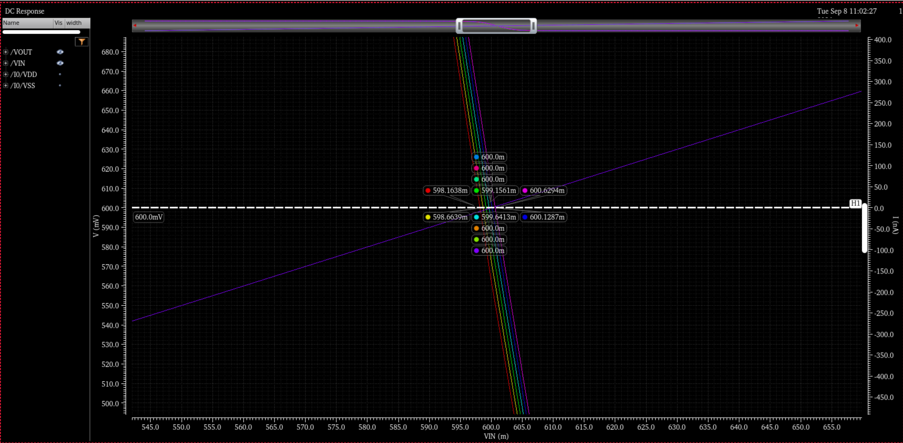](1X_INVERTER/1x_inverter_width_parameter_sweep_marker.png)

</details>

## Timing Measurements

| Metric | Measurement |
| --- | --- |
| Rise time | Output transition from 10% to 90% of VDD |
| Fall time | Output transition from 90% to 10% of VDD |
| t_pHL / t_pLH | Input-to-output delay at the 50% VDD crossings |
| Average propagation delay | `(t_pHL + t_pLH) / 2` |
| Duty cycle | High pulse width / period, measured at 50% VDD |

The first-order interpretation is `t_pd ~ 0.69 * R_on * C_load`. In the size-matched configuration, reduced driver resistance and increased load capacitance approximately cancel. In the multi-load configuration, the load grows faster than the driver conductance, increasing delay.

### NN / 27 C Propagation Delay

| Process | Same Load: 1X / 2X / 4X (ps) | Multi Load: 1X (ps) | Multi Load: 2X (ps) | Multi Load: 4X (ps) |
| --- | --- | ---: | ---: | ---: |
| 180 nm | 34.72 / 34.72 / 34.72 | 34.70 | 45.46 | 66.18 |
| 90 nm | 12.71 / 12.71 / 12.71 | 12.715 | 17.815 | 27.735 |
| 45 nm | 8.04 / 8.04 / 8.04 | 8.03 | 9.96 | 13.66 |

Source: presentation pages 33 and 35. Values are reported simulation measurements for the listed configurations.

<details>
<summary>Propagation-delay tables for all corners</summary>

[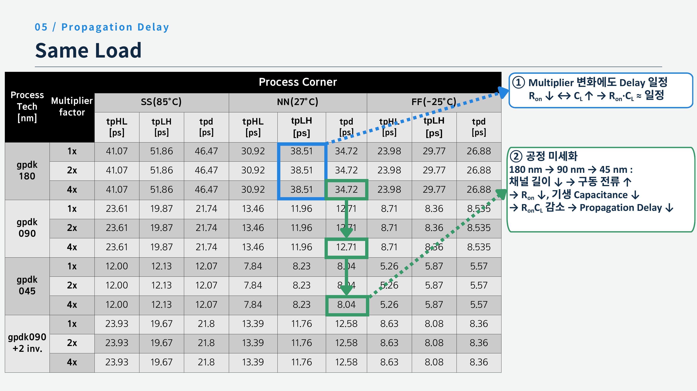](images/report/same-load-delay-results.png)

Source: [project presentation, page 33](Digital_IC_Project_Repeater.pdf#page=33).

[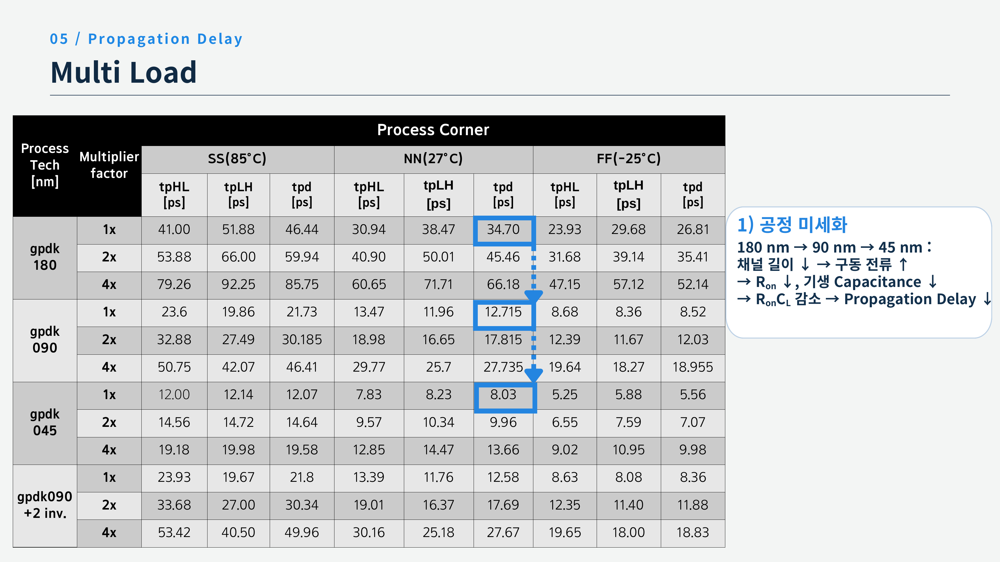](images/report/multi-load-delay-results.png)

Source: [project presentation, page 35](Digital_IC_Project_Repeater.pdf#page=35).

</details>

<details>
<summary>Transient waveforms and corner comparisons</summary>

[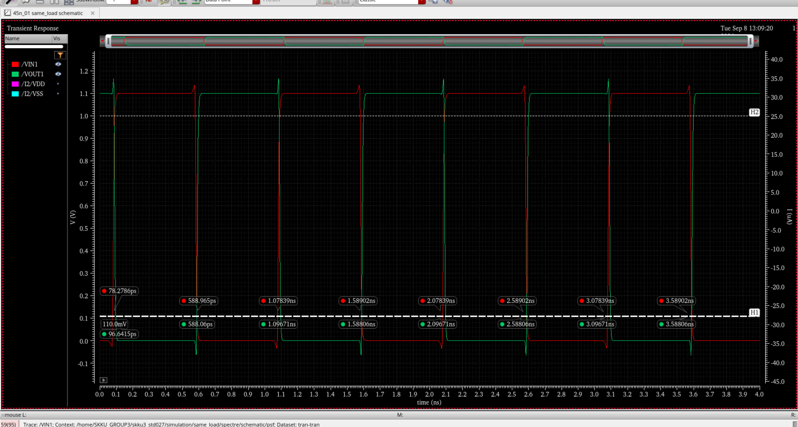](1X_2X_4X_INVERTER_SAME_LOAD/same_load_sim.png)

[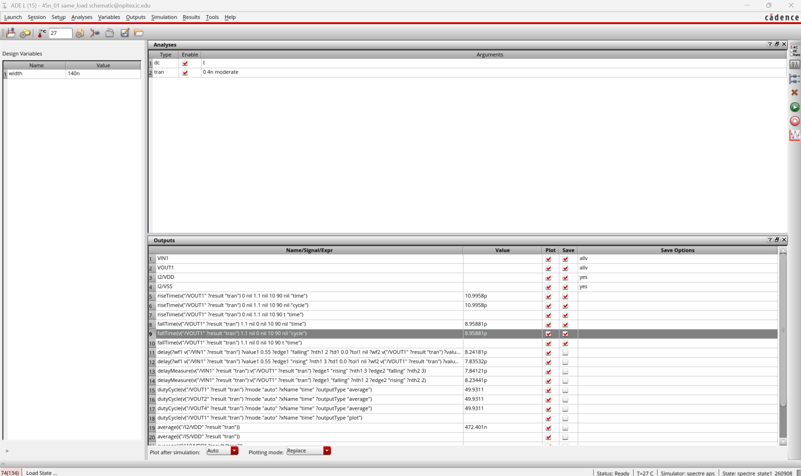](1X_2X_4X_INVERTER_SAME_LOAD/same_load_sim_rising_falling_delay_nn.png)

[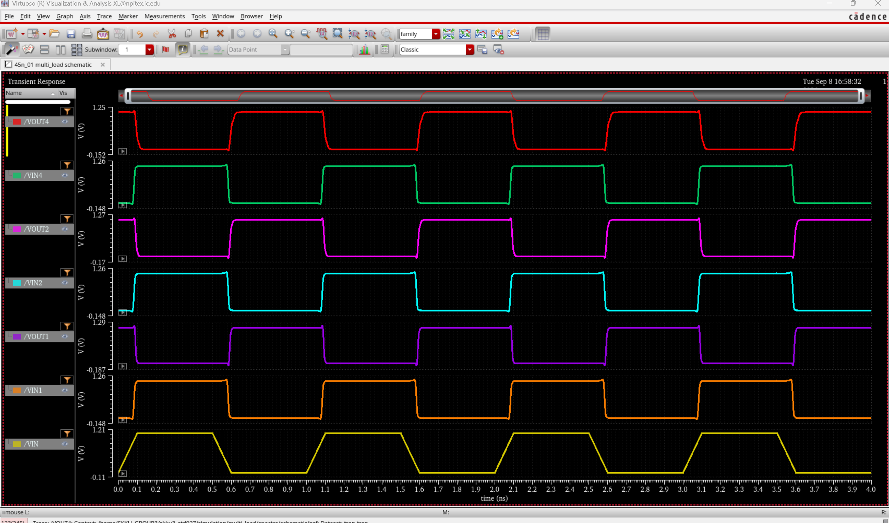](1X_2X_4X_INVERTER_MULTI_LOAD/MULTI_LOAD_sim_NN.png)

</details>

## Current and Power

The study records driver supply and ground currents, compares average current, and examines charging, discharging, short-path current, and capacitive-coupling spikes. At constant supply, average supply power is obtained from `P_avg = VDD * I_DD,avg`.

### NN / 27 C Average Supply Current

| Process | Same Load 1X / 2X / 4X (uA) | Multi Load 1X / 2X / 4X (uA) |
| --- | --- | --- |
| 180 nm | 18.966 / 37.93 / 75.86 | 18.99 / 56.65 / 187.84 |
| 90 nm | 2.18 / 4.37 / 8.73 | 2.18 / 6.84 / 23.67 |
| 45 nm | 0.47 / 0.94 / 1.89 | 0.47 / 1.44 / 4.83 |

Source: presentation pages 44 and 46. These entries are currents; multiplying by the corresponding process supply gives power.

<details>
<summary>Original current-comparison tables</summary>

[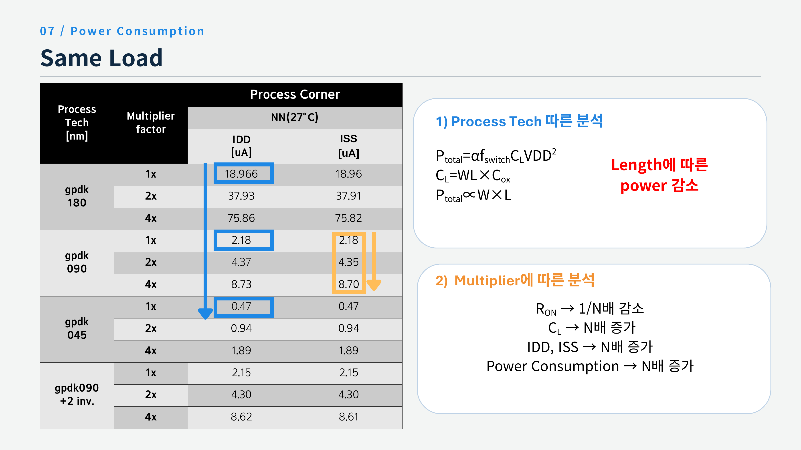](images/report/same-load-current-results.png)

Source: [project presentation, page 44](Digital_IC_Project_Repeater.pdf#page=44).

[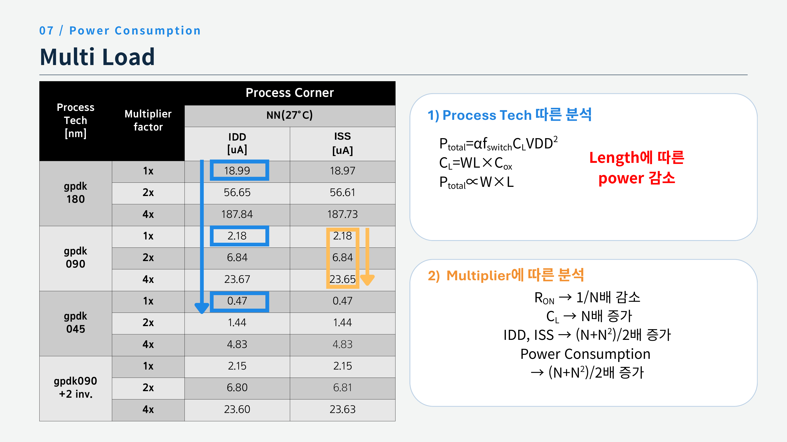](images/report/multi-load-current-results.png)

Source: [project presentation, page 46](Digital_IC_Project_Repeater.pdf#page=46).

</details>

## Main Observations

- Size-matched scaling leaves the reported delay approximately unchanged while increasing current and device area.
- Multi-load scaling increases fanout, delay, and current in the tested circuits.
- Process and temperature combinations affect pull-up/pull-down timing, duty cycle, and current.
- Driver input slew and load definition are part of the comparison conditions.

## Files

| Location | Contents |
| --- | --- |
| [1X_INVERTER](1X_INVERTER/) | Base inverter, VTC sweep, and transient setup |
| [Same-load experiments](1X_2X_4X_INVERTER_SAME_LOAD/) | Schematic, waveforms, and timing markers |
| [Multi-load experiments](1X_2X_4X_INVERTER_MULTI_LOAD/) | Schematic and corner waveforms |
| [result_data](result_data/) | Additional corner captures and beta-ratio explanation |
| [images/report](images/report/) | Presentation figures used in this guide |
| [Presentation](Digital_IC_Project_Repeater.pdf) | Complete 60-page study |
