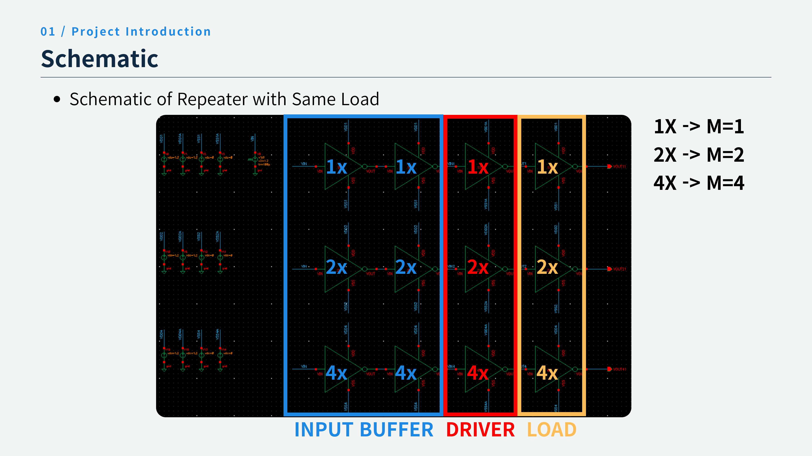
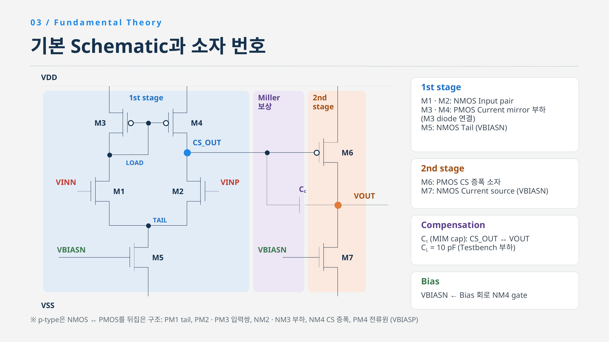
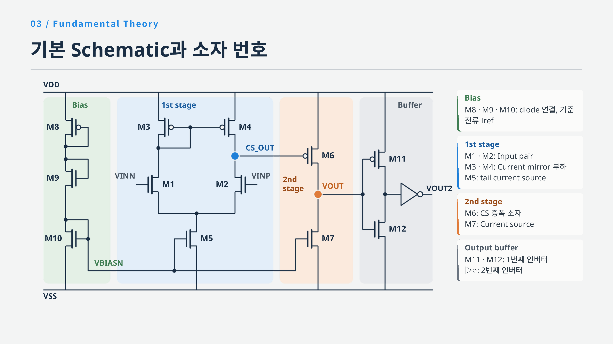

# Digital and Analog IC Design

Cadence Virtuoso circuit-design studies covering **CMOS repeaters**, **Miller-compensated two-stage operational amplifiers**, and **high-speed two-stage comparators**. The projects connect transistor sizing and bias design to measured DC, AC, and transient behavior across process and temperature conditions.

## Project Guide

| Project | Circuit Structure | Main Design Questions | Documentation |
| --- | --- | --- | --- |
| CMOS Repeater | Inverter input buffers, driver, and inverter loads | How do sizing, fanout, process, and temperature affect delay and current? | [Repeater study](DIGITAL_IC_PROJECT_REPEATER/README.md) |
| Two-Stage OP-AMP | Differential stage, common-source stage, Miller capacitor, start-up bias | How are gain, stability, slew rate, and offset balanced? | [OP-AMP study](ANALOG_IC_PROJECT_2STAGE_OP_AMP/README.md) |
| Two-Stage Comparator | Differential stage, common-source stage, inverter output buffers | How fast can the output maintain its required swing and duty cycle? | [Comparator study](ANALOG_IC_PROJECT_2STAGE_COMPARATOR/README.md) |

Circuit and result images are linked to their original files. Click an image to inspect it at full resolution. The project guides combine existing Cadence screenshots with 180 dpi presentation-page renders.

## Common Evaluation Framework

| Study | Process Models | Supply Voltage | Corner / Temperature Combinations |
| --- | --- | --- | --- |
| Repeater | GPDK045, GPDK090, GPDK180 | 1.1 V, 1.2 V, 2.0 V, respectively | SS / 85 C, NN / 27 C, FF / -25 C |
| OP-AMP | GPDK090, GPDK180 | 1.2 V, 2.0 V, respectively | SS / 85 C, NN / 27 C, FF / -25 C |
| Comparator | GPDK090, GPDK180 | 1.2 V, 2.0 V, respectively | SS / 85 C, NN / 27 C, FF / -25 C |

The analog projects compare both NMOS and PMOS differential input pairs. The repeater study compares 1X, 2X, and 4X inverter multipliers under size-matched and multi-load configurations.

## CMOS Repeater

The repeater testbench separates **input buffering**, the **measured driver**, and the **load**. Separate driver supply paths support driver-current measurements. PMOS width sweeps balance the inverter switching point before transient comparisons.

```text
Input stimulus -> Input buffers -> Measured inverter driver -> Inverter load(s)
                                      |
                           VIN, VOUT, IDD, ISS
```

[](DIGITAL_IC_PROJECT_REPEATER/images/report/same-load-topology.png)

The measured behavior is interpreted with the approximate relation `t_pd ~ 0.69 * R_on * C_load`. Scaling a driver and one matching load together keeps their RC product approximately constant; increasing the number of sized loads increases the effective fanout and delay in the multi-load experiment.

For example, at NN / 27 C, the 90 nm same-load results report **12.71 ps** average propagation delay for all three size factors. The multi-load results report approximately **12.72 ps**, **17.82 ps**, and **27.74 ps** for 1X, 2X, and 4X.

[Schematics, sizing, timing tables, and current analysis](DIGITAL_IC_PROJECT_REPEATER/README.md) · [60-page presentation](DIGITAL_IC_PROJECT_REPEATER/Digital_IC_Project_Repeater.pdf)

## Miller-Compensated Two-Stage OP-AMP

The OP-AMP uses a differential input stage with current-mirror load, a common-source second stage, and a **2 pF Miller compensation capacitor**. A start-up and beta-multiplier bias circuit supplies the operating currents. The output is evaluated with a **10 pF load** and in closed-loop amplifier applications.

```text
VINP, VINN -> Differential stage -> CS_OUT -> Common-source stage -> VOUT -> CL
                                      |                            |
                                      +--------- Cc = 2 pF ---------+

Start-up + beta-multiplier -> Bias voltages -> Tail and second-stage currents
```

[](ANALOG_IC_PROJECT_2STAGE_OP_AMP/images/report/opamp-topology.png)

The design targets include open-loop gain of at least **57 dB**, phase margin of at least **60 degrees**, unity-gain frequency of at least **1 MHz**, and input offset magnitude of at most **1.5 mV**. Reported AC results cover four process/input-pair combinations and three corners.

| Design Case | NN Gain (dB) | NN Phase Margin (degrees) | NN Unity-Gain Frequency (MHz) |
| --- | ---: | ---: | ---: |
| 90 nm NMOS | 66.51 | 71.76 | 3.88 |
| 90 nm PMOS | 67.70 | 78.03 | 5.54 |
| 180 nm NMOS | 78.64 | 62.71 | 7.78 |
| 180 nm PMOS | 78.47 | 79.93 | 5.57 |

Source: OP-AMP presentation, page 18. These are simulation results for the stated conditions.

[Four circuit variants, biasing, corner results, and feedback-load experiment](ANALOG_IC_PROJECT_2STAGE_OP_AMP/README.md) · [95-page presentation](ANALOG_IC_PROJECT_2STAGE_OP_AMP/2-Stage%20OP-AMP.pdf)

## High-Speed Two-Stage Comparator

The comparator operates as an open-loop differential amplifier followed by output inverters. Its two gain stages amplify the input difference; the output buffers restore the signal toward the supply rails.

```text
VINP, VINN -> Differential stage -> CS_OUT -> Common-source stage -> VOUT
                                                                        |
                                               VOUT2 <- Inverter buffers
```

[](ANALOG_IC_PROJECT_2STAGE_COMPARATOR/images/report/comparator-topology.png)

Gain and frequency-response measurements use **VOUT**. Duty cycle and output swing use the buffered **VOUT2** node. The design targets are gain above **40 dB**, duty cycle between **40% and 60%**, and output levels reaching below **0.1 VDD** and above **0.9 VDD**.

| Design Case | NN Gain (dB) | NN Reported fmax (GHz) | NN Duty Cycle (%) |
| --- | ---: | ---: | ---: |
| 90 nm NMOS | 46.79 | 2.785 | 45.89 |
| 90 nm PMOS | 40.88 | 3.445 | 51.94 |
| 180 nm NMOS | 51.02 | 1.030 | 46.14 |
| 180 nm PMOS | 51.39 | 0.950 | 54.03 |

Source: comparator presentation, case-result tables on pages 34, 41, 49, and 57. `fmax` is the reported maximum input frequency meeting the swing and duty criteria; it is distinct from unity-gain frequency.

[Input-pair variants, corner tables, and pole-model analysis](ANALOG_IC_PROJECT_2STAGE_COMPARATOR/README.md) · [73-page presentation](ANALOG_IC_PROJECT_2STAGE_COMPARATOR/2-Stage%20Comparator.pdf)

## Design Library and Simulation States

[data/ANALOG_DESIGN.zip](data/ANALOG_DESIGN.zip) contains the analog Cadence library, including amplifier, comparator, bias, device-characterization, and simulation cells. The library includes OpenAccess schematics and symbols together with saved Spectre ADE states.

[Library organization and cell guide](data/README.md)

## Repository Organization

```text
DIGITAL_ANALOG_IC_DESIGN/
|-- DIGITAL_IC_PROJECT_REPEATER/
|   |-- README.md
|   |-- Digital_IC_Project_Repeater.pdf
|   |-- 1X_INVERTER/ and load-comparison screenshots
|   |-- result_data/
|   `-- images/report/
|-- ANALOG_IC_PROJECT_2STAGE_OP_AMP/
|   |-- README.md
|   |-- 2-Stage OP-AMP.pdf
|   |-- 90nm_NMOS_AC/  90nm_NMOS_DC/  90nm_NMOS_TRAN/
|   `-- images/ and images/report/
|-- ANALOG_IC_PROJECT_2STAGE_COMPARATOR/
|   |-- README.md
|   |-- 2-Stage Comparator.pdf
|   `-- images/ and images/report/
|-- data/
|   |-- README.md
|   `-- ANALOG_DESIGN.zip
|-- docs/figure-index.md
`-- README.md
```

## Tools and Source Material

The studies use Cadence Virtuoso, Spectre/ADE, DC operating-point and parameter sweeps, AC analysis, and transient analysis. Each project guide links the corresponding presentation and the original simulation images. [Figure index](docs/figure-index.md) records the source PDF page for every added presentation figure.
